# A Comprehensive Comparative Study of EEG Seizure Detection
### Advanced Signal Processing, Class Imbalance Mitigation and Cross-Dataset Generalization

**An investigation using Bonn, CHB-MIT, and Siena Scalp EEG Datasets**  
*Department of Information Technology, National Institute of Technology, Kurukshetra*

---

## 📌 Project Overview
Automated epileptic seizure detection from electroencephalography (EEG) recordings faces critical clinical hurdles:
1. **Severe Class Imbalance**: Seizure (ictal) events represent a tiny fraction of long-term continuous recordings.
2. **Subject Identity Leakage**: Conventional random window-splitting leaks patient signatures, inflating apparent test accuracy without ensuring clinical generalization to unseen patients.
3. **Cross-Cohort Domain Shift**: Changes in patient demographics (pediatric vs. adult), sensor montages, recording equipment, and sampling rates degrade detector performance.

This project implements a modular, leakage-safe machine learning framework to systematically compare **seven class-imbalance mitigation strategies (E0–E6)** across **three experimental tracks** using conventional classifiers (SVM, Random Forest) and 1D temporal architectures.

---

## 🏗️ Architecture & Pipeline

```mermaid
flowchart LR
    A["Raw EEG Datasets<br/>(Bonn / CHB-MIT / Siena)"] --> B["Quality Control<br/>& Artifact Flagging"]
    B --> C["Harmonization & Filtering<br/>(Bandpass 0.5-40Hz, Notch)"]
    C --> D["Patient-Grouped Split<br/>(Leakage-Safe Partitioning)"]
    D --> E["Feature Extraction<br/>(Time, Welch PSD, Wavelet, Hjorth)"]
    E --> F["Train-Only Imbalance Mitigation<br/>(E0 - E6)"]
    F --> G["Supervised Classifiers<br/>(SVM, Random Forest)"]
    G --> H["Comprehensive Evaluation<br/>(Sensitivity, Specificity, PR-AUC, FA/h)"]
```



---

## 🔬 Experimental Matrix

### Experimental Tracks (Section 4.1)
| Track | Dataset | Split Protocol | Primary Metrics | Objective |
| :--- | :--- | :--- | :--- | :--- |
| **Track A** | Bonn EEG | Segment-level split | Sensitivity, Specificity, F1, PR-AUC | Controlled benchmark on single-channel segments (Set E vs Sets A–D) |
| **Track B** | CHB-MIT | **Patient-Grouped** split | Sensitivity, Precision, F1, **False Alarms/hour (FA/h)** | Clinical validation on pediatric cohort with timeline event reconstruction |
| **Track C** | Siena Scalp | Cross-dataset zero-shot transfer | PR-AUC, Sensitivity, Specificity Drop | External generalization to adult cohort after sampling rate & channel harmonization |

### Class Imbalance Mitigation Strategies (Section 3.4)
- **E0 (Baseline)**: No balancing (trained on raw imbalanced distribution).
- **E1 (ROS)**: Random Over-Sampling (duplicates minority seizure samples).
- **E2 (RUS)**: Random Under-Sampling (reduces majority non-seizure samples).
- **E3 (SMOTE)**: Synthetic Minority Over-sampling Technique in extracted feature space.
- **E4 (Borderline-SMOTE)**: Focuses synthetic generation exclusively in the boundary 'DANGER' zone.
- **E5 (Cost-Sensitive)**: Class-weighted loss penalty (`class_weight='balanced'`).
- **E6 (Signal Augmentation)**: Raw waveform transformation (mild Gaussian jitter, amplitude scaling, small cyclic time shifts preserving spike-wave morphology).

---

## 📂 Project Structure

```text
epileptic_seizure_detection_using_EEG/
├── configs/                  <- YAML configuration files
│   ├── bonn_config.yaml
│   ├── chbmit_config.yaml
│   └── siena_config.yaml
├── data/
│   ├── raw/                  <- Directory for raw datasets (Bonn, CHB-MIT, Siena)
│   ├── processed/            <- Preprocessed windows & cached feature matrices
│   └── README.md             <- Dataset placement and upload guide
├── reports/                  <- Evaluation CSV tables and publication plots
│   └── figures/              <- ROC, PR curves, and comparison bar charts
├── scripts/                  <- CLI runners for experimental tracks
│   ├── run_bonn_benchmark.py
│   ├── run_chbmit_experiment.py
│   ├── run_cross_dataset.py
│   └── generate_project_report.py
├── src/                      <- Core modular source library
│   ├── balancing/            <- Resamplers (E0-E6 implementations)
│   ├── datasets/             <- Pure-Python EDF reader, Bonn & CHB-MIT loaders, mock generator
│   ├── evaluation/           <- Metrics, timeline event reconstruction (FA/h), leakage guards
│   ├── features/             <- Time-domain, Welch PSD, DWT Wavelet, Hjorth parameters
│   ├── models/               <- SVM, Random Forest, Logistic Regression, 1D-CNN
│   ├── pipelines/            <- Modular end-to-end pipelines for Tracks A, B, and C
│   ├── preprocessing/        <- Zero-phase Butterworth & Notch filters, Quality Control, Windowing
│   └── utils/                <- YAML loaders and structured logging
├── tests/                    <- Unit and integration test suite
├── run_project.py            <- Unified command-line entry point
├── run_tests.py              <- Standalone test runner
└── requirements.txt          <- Dependencies list
```

---

## 🚀 Getting Started

### 1. Requirements
Ensure Python (3.11 - 3.13) is available. Install dependencies:
```bash
pip install -r requirements.txt
```

### 2. Verify System & Run Tests
Run the 12-stage test suite to ensure mathematical stability, feature correctness, and leakage guards:
```bash
python run_project.py --test
```

### 3. Running Experimental Tracks
Execute individual tracks or run the entire comparative study:
```bash
# Run Track A: Bonn Controlled Benchmark
python run_project.py --track bonn

# Run Track B: CHB-MIT Patient-Independent Evaluation
python run_project.py --track chbmit

# Run Track C: Siena Cross-Dataset Generalization
python run_project.py --track cross

# Run All Tracks and compile the final summary report
python run_project.py --track all
```

---

## 📤 Uploading Real Datasets
If the raw data directories are empty, the project automatically generates realistic synthetic EEG waveforms to verify functionality. When you are ready to use the official clinical datasets:
1. **Bonn EEG**: Place files into `data/raw/bonn/` (folders `A`, `B`, `C`, `D`, `E` or files prefixed `Z*.txt`, `S*.txt`).
2. **CHB-MIT**: Place patient folders into `data/raw/chbmit/` (e.g. `chb01`, `chb02`, ..., each containing its `.edf` and `*-summary.txt` file).
3. **Siena**: Place patient folders into `data/raw/siena/` (e.g. `pn01`, `pn02`, with `.edf` and `.txt` annotation files).

See [`data/README.md`](data/README.md) for detailed instructions.
